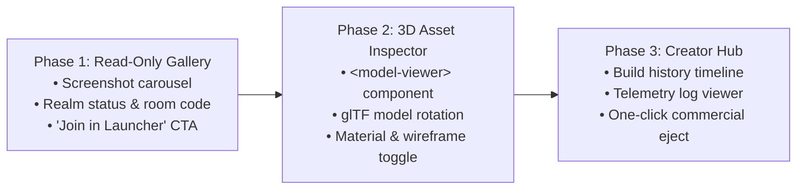

# tokigen Web Studio — Architecture & Handover Specification

**Status:** Parked / Under Construction  
**Audience:** Frontend Engineers, Game Tech Leads, Product Designers  
**Associated UI:** `/studio.html` on `tokigen.gg`

---

## 1. Executive Summary & Vision

The **tokigen Web Studio** is a browser-based companion portal designed to give players and creators a visual window into their games without requiring the native desktop client to be open. 

While full gameplay execution is offloaded to the native Godot launcher (`TokigenLauncher`), the Web Studio fulfills three critical use cases:
1. **Game Gallery & Build Snapshots**: View high-resolution gameplay screenshots, automated test run videos, and level generation captures from every build.
2. **Interactive 3D Asset Inspector**: Rotate, inspect, and preview procedural 3D models (glTF/GLB/TRES converted assets, weapon props, boss models, terrain chunks) directly in WebGL/WebGPU.
3. **Sharable Realm Cards & Social Previews**: Generate shareable URLs for individual realms with dynamic room codes, status indicators (Active / Scale-to-Zero Sleeping), and instant launcher deep-links (`tokigen://join/<room_code>`).

---

## 2. Target User Experience

### 2.1 The Creator Flow
1. A creator issues a prompt via Discord, CLI, or the upcoming prompt interface.
2. The headless pipeline on `playable-server` compiles the `.pck` and invokes a headless Godot instance (`--write-movie` or screenshot capture).
3. Artifacts (`capture.png`, `boss_model.glb`, `manifest.json`) are uploaded to Cloud Storage (`/realms/<room_code>/artifacts/`).
4. The creator visits `tokigen.gg/studio.html?realm=TEST-4821` to inspect the results before inviting friends.

### 2.2 The Player / Friend Flow
1. A player receives a link: `https://tokigen.gg/studio.html?realm=TEST-4821`.
2. The page displays the realm title (*"The Boiling Iron Rig"*), screenshots, boss stats, and active players.
3. A single CTA button: **"Join Game"** triggers `tokigen://join/TEST-4821` (or falls back to downloading the launcher if not installed).

---

## 3. Recommended Technical Stack for Web Studio

### 3.1 3D Asset Viewer
- **Engine Options**:
  - **Option A (Recommended)**: `<model-viewer>` (Google Web Component) — zero bundle weight, handles glTF/GLB with PBR materials, shadows, orbit controls, and AR out of the box.
  - **Option B**: `three.js` / `@react-three/fiber` (or vanilla Three.js in Vite) for custom post-processing, cell shading, or custom shaders.
- **Asset Pipeline**:
  - Godot can export scenes or meshes headlessly to GLTF via `GLTFDocument.new()`.
  - Store assets as compressed binary `.glb` with Draco compression or meshopt.

### 3.2 Gallery & Screenshot Grid
- Lightweight masonry grid using CSS Subgrid or Flexbox.
- Progressive image loading using standard `<picture>` with WebP/AVIF formats.
- Lightbox component built with native HTML `<dialog>` and View Transitions API.

### 3.3 State & API Integration
- Backend endpoints on `playable-server`:
  - `GET /api/realms/:room_code/summary`: Returns realm metadata, active player count, and artifact URLs.
  - `GET /api/realms/:room_code/gallery`: Lists screenshots and video clips.
  - `GET /api/realms/:room_code/assets`: Lists inspectable 3D meshes and materials.
- Read-only public access: No authentication required to view public realm cards. Creator settings protected by standard Bearer JWT.

---

## 4. Phased Implementation Roadmap

### Phase 1: Read-Only Gallery & Room Deep-Linker
- Consume `GET /api/rooms` and display active/recent realms.
- Display screenshot grid and video player for the selected room.
- Include OS download buttons and deep-link launcher protocol `tokigen://join/<room_code>`.

### Phase 2: Interactive 3D Model Inspector
- Integrate `<model-viewer>` into `studio.html`.
- Display generated assets (e.g., `BossWarden.glb`, `CoalVent_01.glb`).
- Add turntable rotation, zoom, wireframe toggle, and environment lighting presets.

### Phase 3: Creator Hub & Build History
- Authentication integration (Google SSO / Guest Creator).
- Build stage timeline visualizer with step durations and bot test results.
- Export / Eject buttons to download raw project archives.

---

## 5. Current File Placement

- **Current Placeholder Page**: `playable-web/studio.html`
- **Main Script**: `playable-web/src/main.ts`
- **Styles**: `playable-web/src/style.css` (classes: `.studio-hero`, `.studio-features`)
- **Localization**: Keys `studio.*` in `playable-web/src/i18n.ts` (English, Portuguese, Japanese)
